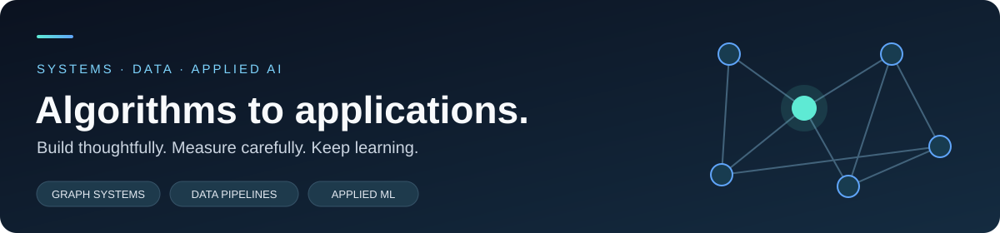

# Mudiam Hemanth Reddy

**AI & Data Science student · Graph computing · Data engineering · Applied ML**

Amrita Vishwa Vidyapeetham, Coimbatore

[Portfolio](https://hemanthf224.github.io/hemanth-portfolio/) · [LinkedIn](https://www.linkedin.com/in/hemanth-reddy-9517b0340/) · [Resume](https://github.com/Hemanthf224/hemanth-portfolio/raw/master/M%20HEMANTH%20REDDY.pdf) · [Email](mailto:hemanthreddy48823@gmail.com)

I build projects that connect algorithms with usable systems: graph engines with Python interfaces, distributed pipelines for transport data, and machine learning services with dashboards. I am open to **internships and research collaborations** in systems, data engineering, and applied AI.

## Explore my work

| Interested in… | Start with | Look for |
| --- | --- | --- |
| Parallel and systems programming | [Adaptive Graph Engine](https://github.com/Hemanthf224/adaptive-graph-engine) | Native build, graph algorithms, and Python bindings |
| Data engineering | [TaxiPulse](https://github.com/Hemanthf224/TaxiPulse_Bigdata) | Spark pipeline, data quality, and a small-data starting point |
| Applied machine learning | [SDN-OSHLD](https://github.com/Hemanthf224/SDN-OSHLD) | Model workflow, API, and current evaluation scope |

## Featured projects

### [Adaptive Graph Engine](https://github.com/Hemanthf224/adaptive-graph-engine)

Graph analytics across CPU, GPU, and distributed execution, with Python bindings and an interactive dashboard.

- **Core work:** CSR graphs, traversal and ranking algorithms, CUDA kernels, and an MPI PageRank path.
- **Stack:** C++17 · CUDA · OpenMP · MPI · pybind11 · React · FastAPI.
- **Current focus:** portable builds, correctness checks, and reproducible benchmarks. Research extensions are experimental.

### [TaxiPulse](https://github.com/Hemanthf224/TaxiPulse_Bigdata)

A data engineering pipeline that turns NYC taxi trip files into cleaned, enriched, partitioned datasets for analysis and regression experiments.

- **Core work:** unify trip schemas, join weather and zone references, build features, and simulate Kafka streams.
- **Stack:** Scala · Apache Spark · HDFS · Kafka · Docker.
- **Current focus:** repeatable small-data runs, documented model evaluation, and portable setup.

### [SDN-OSHLD](https://github.com/Hemanthf224/SDN-OSHLD)

A network attack-classification prototype connecting model training, ensemble inference, policy recommendations, and a web dashboard.

- **Core work:** classifier training and inference through a FastAPI service with Flask visualizations.
- **Stack:** Python · scikit-learn · XGBoost · LightGBM · PyTorch · FastAPI.
- **Current focus:** independent evaluation and a reproducible training workflow. QoS responses currently use simulated values.

## Tools I use

| Area | Tools used in my projects |
| --- | --- |
| Languages | Python, C++, Scala |
| Systems and parallel computing | CUDA, OpenMP, MPI, CMake |
| Data engineering | Spark, HDFS, Kafka, Parquet |
| Machine learning | scikit-learn, PyTorch, XGBoost, LightGBM |
| Applications and workflows | FastAPI, Flask, React, Docker, Git |

## Experience

**AI & Data Science Intern · XYlofy AI · May–June 2026**

Worked on financial fraud detection using LightGBM, XGBoost, and Isolation Forest. Explored SMOTE for class imbalance and SHAP explanations in a Streamlit dashboard.

**Team leader · Team Ahjin**

Coordinated hackathon prototype development, system design, and technical presentations.

## Research

| Work | Status |
| --- | --- |
| Ornithopter Flight Dynamics — AJK-OFM Aerodynamic Model | Presented at IEEE SPICES 2026, paper #2458 |
| Ambient Environment Monitoring Rover | Under revision |
| Federated Graph Attention for IoT Anomaly Detection | Manuscript in progress |
| QKD Eavesdropping Detection via Sequence-based QBER Analysis | Research in progress |

## What I am working toward

- Reproducible experiments with documented datasets, environments, and evaluation methods.
- Clear setup guides, useful examples, and stronger tests for my projects.
- Open-source contributions through bug fixes, documentation, and thoughtful reviews.

## Get in touch

For internship opportunities, research discussions, or project collaboration: **[hemanthreddy48823@gmail.com](mailto:hemanthreddy48823@gmail.com)**.
