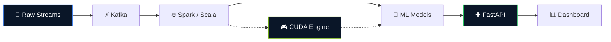

<div align="center">

<!-- ═══════════════════ HEADER ═══════════════════ -->


<a href="https://git.io/typing-svg">
  
</a>

<br/><br/>

[](mailto:hemanthredy48823@gmail.com)
[](https://github.com/Hemanthf224)
[](https://github.com/Hemanthf224)
[](mailto:hemanthredy48823@gmail.com)

</div>

---


### `$ whoami`

```python
class HemanthReddy:

    name         = "Mudiam Hemanth Reddy"
    location     = "Coimbatore, India 🇮🇳"
    degree       = "B.Tech · AI & Data Science"
    university   = "Amrita Vishwa Vidyapeetham"
    cgpa         = 8.26

    focus        = [
        "GPU-accelerated systems",
        "Distributed ML pipelines",
        "Quantum security research",
    ]
    building     = "Adaptive Graph Engine · C++20 / CUDA"
    researching  = "Federated learning · QKD · Flight dynamics"
    mission      = "Make ML models scale — from raw data to GPU execution"
    ask_me_about = ["CUDA", "Big Data", "REST APIs", "Fraud detection"]
    email        = "hemanthredy48823@gmail.com"
```

<br clear="right"/>

---

### ⚡ Current Focus

<table>
  <tr>
    <td align="center" width="33%">
      <br/>
      <sub>C++20 · CUDA · OpenMP · MPI</sub>
    </td>
    <td align="center" width="33%">
      <br/>
      <sub>QKD · Federated Learning · Qiskit</sub>
    </td>
    <td align="center" width="33%">
      <br/>
      <sub>CUDA optimization · Systems design</sub>
    </td>
  </tr>
</table>

---

### 🚀 Flagship Projects

<table>
  <tr>
    <td width="50%" valign="top">
      <h3>⚡ Adaptive GPU Graph Engine</h3>
      <p>Zero-overhead GPU/CPU co-scheduling for graph workloads. Dynamically profiles hardware topology and routes BFS/PageRank between CUDA kernels and OpenMP threads — achieving <b>up to 4× speedup</b> over CPU baselines.</p>
      <p>
        
        
        
        
      </p>
      <a href="https://github.com/Hemanthf224/adaptive-graph-engine"><b>View Repository →</b></a>
    </td>
    <td width="50%" valign="top">
      <h3>🚕 TaxiPulse · Big Data Pipeline</h3>
      <p>Distributed end-to-end pipeline over <b>17 GB / 11M+ records</b> from NYC Taxi. Kafka ingestion → Spark MLlib → Demand, fare & ETA prediction. Deployed with Scala and Hadoop on a multi-node cluster.</p>
      <p>
        
        
        
        
      </p>
      <a href="https://github.com/Hemanthf224/TaxiPulse_Bigdata"><b>View Repository →</b></a>
    </td>
  </tr>
  <tr>
    <td width="50%" valign="top">
      <h3>🛡️ SDN-OSHLD · Intrusion Detection</h3>
      <p>Real-time network attack classifier built on CICIDS2017 benchmark. PyTorch deep learning + FastAPI microservice achieving <b>99.2% accuracy</b> across 11 attack categories in SDN environments.</p>
      <p>
        
        
        
        
      </p>
      <a href="https://github.com/Hemanthf224/SDN-OSHLD"><b>View Repository →</b></a>
    </td>
    <td width="50%" valign="top">
      <h3>💳 Fraud Detection AI · XYlofy AI</h3>
      <p>End-to-end financial fraud detection addressing severe class imbalance with SMOTE. Benchmarked LightGBM, XGBoost and Isolation Forest. Shipped an interactive <b>Streamlit + SHAP</b> risk dashboard.</p>
      <p>
        
        
        
        
      </p>
      <sub><i>Built during AI & Data Science internship @ XYlofy AI</i></sub>
    </td>
  </tr>
</table>

---

### 🏗️ System Architecture — How I Think

```
                    ┌──────────────────────────────────────────────────────┐
   RAW DATA  ──────▶│  Kafka Ingestion  →  Spark Processing  →  ML Models │
                    │                          │                            │
                    │              GPU Engine (CUDA)  ◀──────────────────── │
                    │                          │                            │
                    │          FastAPI Service  →  Live Dashboard           │
                    └──────────────────────────────────────────────────────┘
```



---

### 🧰 Tech Arsenal

<div align="center">

**Languages**

[](https://www.python.org)
[](https://isocpp.org)
[](https://www.scala-lang.org)
[](https://www.java.com)

**AI / ML / Research**

[](https://pytorch.org)
[](https://www.tensorflow.org)
[](https://scikit-learn.org)
[](https://qiskit.org)

**GPU & Big Data Systems**

[](https://developer.nvidia.com/cuda-zone)
[](https://spark.apache.org)
[](https://kafka.apache.org)
[](https://hadoop.apache.org)

**Backend & DevOps**

[](https://fastapi.tiangolo.com)
[](https://www.docker.com)
[](https://git-scm.com)
[](https://www.linux.org)

</div>

---

### 📄 Research & Publications

| # | Paper | Venue | Status |
|:-:|:------|:------|:------:|
| 1 | **Ornithopter Flight Dynamics — AJK-OFM Aerodynamic Model** | IEEE SPICES 2026 · Paper #2458 | ✅ Presented |
| 2 | **Ambient Environment Monitoring Rover** | IEEE Conference | 🔄 Under Revision |
| 3 | **FGAT-RL: Federated Graph Attention for IoT Anomaly Detection** | In Submission | ✍️ Writing |
| 4 | **QKD Eavesdropping Detection via Sequence-based QBER Analysis** | Research Project | 🔬 In Progress |

---

### 💼 Experience

<details>
<summary><b>🏢 AI & Data Science Intern — XYlofy AI &nbsp;|&nbsp; May – Jun 2026</b></summary>
<br/>

- Engineered an end-to-end **real-time financial fraud detection system** evaluated with Explainable AI (SHAP).
- Benchmarked **LightGBM, XGBoost, and Isolation Forest** against severe class imbalance using SMOTE oversampling.
- Deployed an interactive **Streamlit risk dashboard** with SHAP feature attribution plots and real-time scoring API.

</details>

<details>
<summary><b>🏅 Hackathon Team Leader &nbsp;|&nbsp; Competitive & Inter-college Events</b></summary>
<br/>

- Led a cross-disciplinary team through multiple competitive hackathons, directing technical strategy and architecture.
- Designed ML pipeline architecture and system design blueprints under time-constrained environments.
- Coordinated across research, engineering, and presentation tracks to deliver end-to-end prototypes.

</details>

<details>
<summary><b>🎓 Certifications</b></summary>
<br/>

- **NVIDIA Deep Learning Institute** — *Getting Started with AI on Jetson Nano*
- **XYlofy AI** — *AI & Data Analytics Internship Certificate*
- **Job Simulation** — *GenAI Powered Data Analytics Certificate*
- **Amrita Vishwa Vidyapeetham** — *B.Tech AI & Data Science · CGPA: 8.26 / 10.0*

</details>

---

### 📊 Activity & Metrics

<div align="center">


<br/>


<br/><br/>

<picture>
  <source media="(prefers-color-scheme: dark)" srcset="https://raw.githubusercontent.com/Hemanthf224/Hemanthf224/output/github-contribution-grid-snake-dark.svg">
  <source media="(prefers-color-scheme: light)" srcset="https://raw.githubusercontent.com/Hemanthf224/Hemanthf224/output/github-contribution-grid-snake.svg">
  
</picture>

</div>

---

### 🗺️ Roadmap

```
 ✅  Fraud detection system with Explainable AI (SHAP)
 ✅  Big Data taxi pipeline — Hadoop · Spark · Kafka (17 GB / 11M records)
 ✅  IEEE SPICES 2026 research presentation
 🔵  Adaptive GPU Graph Engine — public release with benchmarks
 🔵  Federated learning & QKD papers — submission
 🔵  Open-source contribution to a GPU / distributed systems project
 🔵  ML internship at a product company
```

---

### 🤝 Connect

<div align="center">

[](https://hemanthf224.github.io/hemanth-portfolio/)
[](https://www.linkedin.com/in/hemanth-reddy-9517b0340/)
[](mailto:hemanthredy48823@gmail.com)
[](https://github.com/Hemanthf224/hemanth-portfolio/raw/master/M%20HEMANTH%20REDDY.pdf)

<br/>

<a href="https://github.com/Hemanthf224">
  
</a>

<br/><br/>

<sub>💡 Always open to internships, research collaborations, and interesting engineering problems.</sub>

<br/><br/>

<!-- If you've made it here, let's build something remarkable together. -->


</div>
