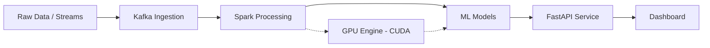

<div align="center">
  
  <a href="https://git.io/typing-svg">
    
  </a>
  <br/><br/>
  <a href="mailto:hemanthredy48823@gmail.com"></a>
  <a href="https://github.com/Hemanthf224"></a>
  <a href="https://www.amrita.edu"></a>
  <a href="mailto:hemanthredy48823@gmail.com"></a>
</div>

---

### 🧠 About Me

```python
class Hemanth:
    degree       = "B.Tech, AI & Data Science (Amrita, Coimbatore)"
    role         = "AI & Data Engineer"
    building     = "Adaptive GPU-accelerated graph engine (C++ / CUDA)"
    research     = ["Quantum security", "Federated learning", "Flight dynamics"]
    team         = "Leader of Team Ahjin (hackathons)"
    mission      = "Make ML models scale, from streaming data to GPU execution"
    ask_me_about = ["GPU computing", "Big Data", "Fraud detection", "REST APIs"]
```

> **Mission:** Bridge the gap between theoretical machine learning and production-ready systems.

---

### ⚡ Currently Working On

| 🔭 Focus | 🛠️ Stack | 📈 Status |
|:---|:---|:---:|
| **Adaptive GPU Graph Engine** | `C++20`, `CUDA`, `OpenMP`, `MPI` |  |
| **Research papers (IEEE)** | `Python`, `Qiskit`, `MATLAB` |  |
| **Learning** | `Distributed systems`, `CUDA optimization` |  |

---

### 🚀 Featured Projects

<table>
  <tr>
    <td width="50%" valign="top">
      <h3>🔥 Adaptive GPU Graph Engine</h3>
      <p>Graph processing that dynamically schedules work across CPU and GPU based on the hardware and the graph.</p>
      <p>
        
        
        
        
      </p>
      <a href="https://github.com/Hemanthf224/adaptive-graph-engine"><b>View Repo →</b></a>
    </td>
    <td width="50%" valign="top">
      <h3>🚕 TaxiPulse: Big Data Pipeline</h3>
      <p>Distributed pipeline over 17GB+ (11M+ records) with Kafka streaming and Spark MLlib for demand, fare and ETA prediction.</p>
      <p>
        
        
        
        
      </p>
      <a href="https://github.com/Hemanthf224/TaxiPulse_Bigdata"><b>View Repo →</b></a>
    </td>
  </tr>
  <tr>
    <td width="50%" valign="top">
      <h3>🛡️ SDN-OSHLD: Intrusion Detection</h3>
      <p>Real-time network attack detection with 99.2% accuracy on the CICIDS2017 benchmark.</p>
      <p>
        
        
        
      </p>
      <a href="https://github.com/Hemanthf224/SDN-OSHLD"><b>View Repo →</b></a>
    </td>
    <td width="50%" valign="top">
      <h3>💳 Fraud Detection AI</h3>
      <p>Fixed severe class imbalance using SMOTE, compared LightGBM, XGBoost and Isolation Forest, and shipped a Streamlit risk dashboard.</p>
      <p>
        
        
        
      </p>
      <sub><i>Built during XYlofy AI internship</i></sub>
    </td>
  </tr>
</table>

---

### 🏗️ How My Systems Think



---

### 🧰 Tech Arsenal

<div align="center">

#### Languages
[](https://www.python.org)
[](https://isocpp.org)
[](https://www.scala-lang.org)
[](https://www.java.com)

#### AI / ML
[](https://www.tensorflow.org)
[](https://scikit-learn.org)
[](https://xgboost.readthedocs.io)

#### Big Data & Systems
[](https://developer.nvidia.com/cuda-zone)
[](https://spark.apache.org)
[](https://kafka.apache.org)
[](https://hadoop.apache.org)

#### Backend & Tools
[](https://fastapi.tiangolo.com)
[](https://www.docker.com)
[](https://git-scm.com)
[](https://streamlit.io)
[](https://www.mathworks.com)

</div>

---

### 📄 Research & Publications

| Paper | Venue | Status |
|:---|:---|:---:|
| **Ornithopter Flight Dynamics (AJK-OFM)** | IEEE SPICES 2026, Paper ID 2458 | ✅ Presented |
| **Ambient Monitoring Rover** | IEEE Conference | 🔄 Revision |
| **FGAT-RL: Federated Learning for IoT Anomaly Detection** | Academic paper | ✍️ Writing |
| **QKD Eavesdropping Detection (sequence-based QBER)** | Research project | 🔬 In progress |

---

### 🏆 Experience & Achievements

<details>
<summary><b>💼 Internship</b></summary>
<br/>
<b>AI & Data Science Intern — XYlofy AI (Remote, May to June 2026)</b><br/>
• Built an end-to-end real-time financial fraud detection system evaluated with explainable AI.<br/>
• Benchmarked LightGBM, XGBoost, and Isolation Forest against severe class imbalance with SMOTE.<br/>
• Deployed an interactive Streamlit risk analysis dashboard with SHAP feature attribution.
</details>

<details>
<summary><b>🏅 Hackathons & Leadership</b></summary>
<br/>
<b>Team Leader, Team Ahjin</b><br/>
• Directing technical strategy, system architecture, and machine learning pipelines across competitive hackathons.
</details>

<details>
<summary><b>🎓 Certifications</b></summary>
<br/>
• <b>NVIDIA Deep Learning Institute</b>: <i>Getting Started with AI on Jetson Nano</i><br/>
• <b>XYlofy AI</b>: <i>AI & Data Analytics Internship Certificate</i><br/>
• <b>Job Simulation</b>: <i>GenAI Powered Data Analytics Certificate</i><br/>
• <b>Amrita Vishwa Vidyapeetham</b>: <i>B.Tech AI & Data Science (CGPA: 8.26 / 10.0)</i>
</details>

---

### 📊 Telemetry & Metrics

<div align="center">
  
  
  <br/><br/>
  
  <br/><br/>
  <!-- Contribution Grid Snake Animation -->
  <picture>
    <source media="(prefers-color-scheme: dark)" srcset="https://raw.githubusercontent.com/Hemanthf224/Hemanthf224/output/github-contribution-grid-snake-dark.svg">
    <source media="(prefers-color-scheme: light)" srcset="https://raw.githubusercontent.com/Hemanthf224/Hemanthf224/output/github-contribution-grid-snake.svg">
    
  </picture>
</div>

---

### 🗺️ Roadmap

- [x] Fraud detection system with explainable AI
- [x] Big data taxi pipeline (Hadoop, Spark, Kafka)
- [x] Present research paper at IEEE SPICES 2026
- [ ] Ship adaptive GPU graph engine with live dashboard
- [ ] Publish quantum security and federated learning papers
- [ ] Contribute to an open-source GPU or data project

---

### 🤝 Let's Connect

<div align="center">

  <a href="https://hemanthf224.github.io/hemanth-portfolio/"></a>
  <a href="https://www.linkedin.com/in/hemanth-reddy-9517b0340/"></a>
  <a href="mailto:hemanthredy48823@gmail.com"></a>
  <a href="https://github.com/Hemanthf224/hemanth-portfolio/raw/master/M%20HEMANTH%20REDDY.pdf"></a>

  <br/><br/>

  <a href="https://github.com/Hemanthf224">
    
  </a>

  <br/>
  <sub>💡 Open to internships, research collaborations and hackathon teams.</sub>
  <br/><br/>

  <!-- You found the easter egg. Let's build something together. -->
  

</div>
